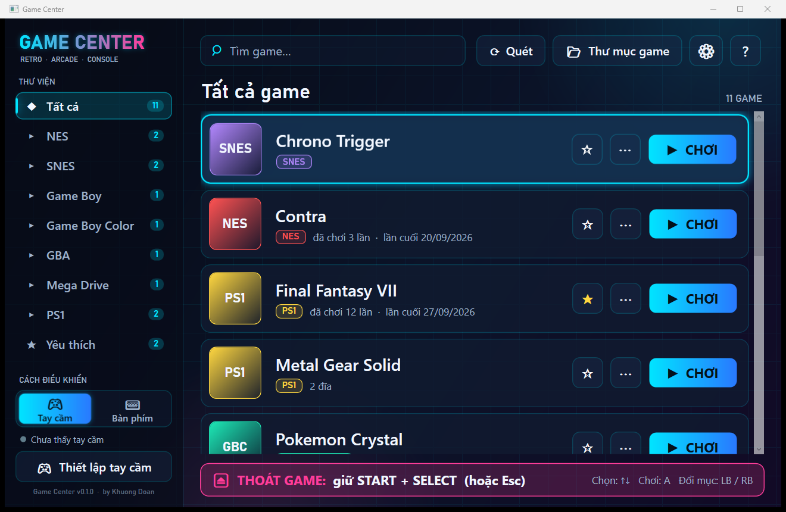

# Game Center

[Tiếng Việt](README.md) · **English**

A **free** retro game launcher for **Windows, macOS and Linux**, designed for older players: large text, big buttons, controller or keyboard. Every console runs through RetroArch. The interface is available in **Vietnamese and English** (click the 🌐 button in the bottom-left corner to switch).

```text
Install → Next → Finish → Copy games → Play
```



## Download

Get it from [Releases](https://github.com/2ez4gcx/game-center/releases). Every build already includes .NET 8, RetroArch and the emulator cores; nothing else to install. **No games or BIOS files are included.**

| OS | File | How to install |
|---|---|---|
| **Windows** 10/11 (64-bit) | `GameCenter-Setup-x.y.z.exe` | Run it, click Next → Finish. Pick **English** on the first screen and Game Center starts in English |
| **macOS** Apple chip (M1–M4) | `GameCenter-x.y.z-macos-arm64.dmg` | Open it and drag **Game Center** into **Applications** |
| **macOS** Intel | `GameCenter-x.y.z-macos-x86_64.dmg` | Same as above |
| **Linux** (64-bit) | `GameCenter-x.y.z-x86_64.AppImage` | Make it executable (`chmod +x`), then double-click |

**Windows:** no admin rights needed, installs to `C:\GameCenter` by default (another drive can be chosen). Games, saves and BIOS live inside the install folder. Uninstalling **does not delete** games or saves.

> ⚠️ **The macOS and Linux builds have not been tested on real machines yet.** They build and pass the automated tests on both systems. If something goes wrong, please [open an issue](https://github.com/2ez4gcx/game-center/issues) and attach `~/GameCenter/Logs/gamecenter.log`. The Windows build is fully tested.

**macOS / Linux:** games, saves and BIOS live in `~/GameCenter`. On macOS, the first time, **right-click → Open** because the app is not notarized by Apple.

## Supported consoles

| Console | Formats | Core | Core license |
|---|---|---|---|
| NES | `.nes`, `.zip` | FCEUmm | GPLv2 |
| SNES | `.sfc`, `.smc`, `.zip` | Snes9x | Non-commercial |
| Game Boy / Color | `.gb`, `.gbc`, `.zip` | Gambatte | GPLv2 |
| GBA | `.gba`, `.zip` | mGBA | MPL 2.0 |
| Master System / Game Gear | `.sms`, `.gg`, `.zip` | Genesis Plus GX | Non-commercial |
| Mega Drive / Genesis | `.md`, `.gen`, `.smd`, `.bin`, `.zip` | Genesis Plus GX | Non-commercial |
| PS1 | `.cue`, `.bin`, `.pbp`, `.chd`, `.ccd`, `.m3u` | Beetle PSX HW | GPLv2 |
| **PS2** | `.iso`, `.chd`, `.cso`, `.zso`, `.cue`/`.bin`, `.m3u` | LRPS2 | GPLv3 |

PS1 games run without a BIOS (OpenBIOS). Adding a BIOS you backed up yourself to the `BIOS` folder improves compatibility.

**PS2 requires a BIOS** dumped from your own PS2: copy the BIOS file (usually `SCPH-xxxxx.bin`, 4 MB, any name works) straight into the `BIOS` folder and Game Center moves it to where the core expects it (`BIOS/pcsx2/bios/`). PS2 needs a fairly powerful computer (a 4-core CPU and a dedicated or recent built-in GPU) and a controller with analog sticks. PS2 on Apple-chip Macs is untested.

## How is Game Center different from RetroArch?

Game Center **does not replace** RetroArch; it is a simple layer on top. RetroArch and its cores still run the games; Game Center handles everything else so the player never has to touch RetroArch.

| | RetroArch on its own | Game Center |
|---|---|---|
| **Role** | Multi-system emulator that runs games | Launcher: manages games, calls RetroArch to play |
| **Setup** | Download each core, set up folders, BIOS, controllers yourself | Installer ships RetroArch, 7 cores and the configuration |
| **Adding games** | Scan or build playlists in the menu, pick the right core | Copy into `Games`; the console is detected from the file content |
| **PS1 / PS2** | Handle `.cue` files, write `.m3u` for multi-disc games, place the PS2 BIOS yourself | Tells PS1 and PS2 discs apart, merges discs, creates `.cue` for loose `.bin`, creates `.m3u`, places the PS2 BIOS |
| **Interface** | Many nested menus, small text, hundreds of options | One screen, large text, a "Play" button |
| **Controls** | Map buttons yourself; default hotkeys are easy to hit by accident | WASD/IJKL keys out of the box, risky hotkeys disabled, simple key-mapping window |
| **Exiting a game** | Need to know the key combo or use the menu | Always shown on screen; press twice to exit so a slip does not lose progress |
| **Save states** | Manual, or silent auto-save | Asks when you exit and when you come back, in plain words |
| **Extras** | Available, deep in the menus | Favorites, recently played, accent-insensitive search, save backup |

## Usage

**Adding games:** copy them into the `Games` folder; everything in one place is fine. Game Center recognizes the console from the file content and shows new games after a few seconds.

- `.cue` + `.bin` appear once; multi-disc games (including loose `.chd`, `.iso` named `(Disc 1)`, `(Disc 2)`) are merged and discs can be changed while playing.
- PS1 vs PS2 discs are told apart by their content (`SYSTEM.CNF`), no need to sort them into folders.
- `.bin` / `.rom` without `.cue`: detected as a PS1 / PS2 disc or a cartridge ROM (NES, Game Boy, GBA, Mega Drive, Master System...) from its header.
- `.zip` with several ROMs: each ROM becomes a game.
- Files that cannot run (`.7z`, `.rar`, multi-part archives, disc games inside `.zip`, consoles not supported yet...) appear under **Not recognized** with instructions. All cases are described (in Vietnamese) in [docs/nhan-dien-file-nen.md](docs/nhan-dien-file-nen.md).
- BIOS files copied into `Games` by mistake are moved to the `BIOS` folder automatically.

**Controls:** choose **Controller** or **Keyboard** in the bottom-left corner; the keyboard always works alongside a controller.

| Controller | Keyboard (default) |
|---|---|
| D-pad ↑ ← ↓ → | W A S D |
| X / Y / B / A | I / J / K / L |
| L1 / L2 | Q / E |
| R1 / R2 | U / O |
| START / SELECT | Enter / Space |

Change keys with **Set up keys** (click a box, then press the new key).

**Exiting a game:** press **START + SELECT** on the controller, or **Esc** on the keyboard, **twice in a row**. The first press only shows "Press again to quit...", so a single slip never ends your game. **F1** opens the emulator menu (changing discs…), **F2 / F4** quick save / load. The emulator menu uses the same language as Game Center.

**Saves:**
- In-game saves (memory cards, cartridge saves) are always kept and written to disk every 10 seconds.
- When you exit, Game Center asks whether to **save your place**; next time it asks whether to **continue** or **start over**. This can be turned off in Settings.
- **Settings → Back up saves** zips all saves (including PS2 memory cards) into a dated file.

**Using an existing PS1 memory card save** (from another emulator or downloaded):

1. Close the game (RetroArch only reads memory cards when a game starts).
2. **Settings → Open saves folder**, go into **`Beetle PSX HW`**:
   - Windows: `<install folder>\Saves\Beetle PSX HW\` (default `C:\GameCenter\Saves\Beetle PSX HW\`)
   - macOS / Linux: `~/GameCenter/Saves/Beetle PSX HW/`
3. If a `.srm` file with the same name exists, copy it somewhere else as a backup.
4. Copy the memory card file in and **rename it to exactly the game's file name** (original name, including "(USA)") with the `.srm` extension:

   | Game runs from | Save file name |
   |---|---|
   | `Yu-Gi-Oh! Forbidden Memories (USA).bin` or `.cue` | `Yu-Gi-Oh! Forbidden Memories (USA).srm` |
   | Multi-disc: `Metal Gear Solid (Disc 1).cue`, `(Disc 2).cue` | `Metal Gear Solid.srm` (shared by all discs) |
   | `.chd` / `.pbp` | that file name + `.srm` |

5. Start the game and go to the Load screen: the save is on Memory Card 1.

| Memory card format | From | How to use |
|---|---|---|
| `.mcr`, `.mcd`, `.mc`, `.srm` (exactly 128 KB) | ePSXe, DuckStation, PCSX, RetroArch | Just rename to `.srm` |
| `.gme` | DexDrive | Convert first with [MemcardRex](https://github.com/ShendoXT/memcardrex) |
| `.psv`, `.mcs`, `.psx` | PS3, single-game saves | Use MemcardRex to copy into an empty card, save as `.mcr`, then rename |

A ready-to-use file must be exactly **131,072 bytes (128 KB)**.

**Using the launcher with a controller:** ↑↓ choose a game, A play, LB/RB switch list, Y favorite, X more options, START settings, SELECT help.

## Development

Requires the .NET 8 SDK.

```
dotnet test
dotnet run --project src/GameCenter.Desktop
```

To use a separate data folder while testing, set the `GAMECENTER_DATA_DIR` environment variable.

| Folder | Contents |
|---|---|
| `src/GameCenter.Core` | Game scanning and detection, SQLite, `retroarch.cfg` generation, key mapping, save states, launching RetroArch |
| `src/GameCenter.Core/Localization/Lang` | UI strings `vi.json`, `en.json`. To add a language, add `<code>.json` with the same keys (tests check for missing keys and placeholders) |
| `src/GameCenter.Desktop` | Avalonia UI (Windows / macOS / Linux), controller input via SDL2 |
| `tests/GameCenter.Tests` | Tests |
| `Defaults/` | `platforms.json` (core per console), `retroarch-base.cfg` |
| `Licenses/` | Licenses for Game Center, RetroArch and each core |
| `installer/` | Windows installer (Inno Setup); writes the chosen language to `Defaults/installer.ini` |
| `tools/package-linux.sh`, `tools/package-macos.sh` | AppImage (Linux) and .dmg (macOS) packaging |
| `.github/workflows/release.yml` | Tests on 3 OSes; pushing a `v*` tag builds packages and drafts a Release |
| `tools/fetch-retroarch.ps1` | Downloads RetroArch, cores and their licenses into the publish folder |

Release:

```
./build.ps1                                                   # test + self-contained publish (bundles .NET 8)
./tools/fetch-retroarch.ps1 -Version 1.22.2                   # RetroArch + cores + licenses
& "C:\Program Files\Inno Setup 7\ISCC.exe" installer\GameCenter.iss
```

Linux / macOS (run on that OS, or let GitHub Actions build on tag push):

```
bash tools/package-linux.sh 1.22.2
bash tools/package-macos.sh arm64 1.22.2      # or x86_64
```

Detailed design (Vietnamese): [GAME_CENTER_IMPLEMENTATION.md](GAME_CENTER_IMPLEMENTATION.md).

## License

Game Center is free, with no ads and no paid features. RetroArch and each core keep their own licenses (see `Licenses/`). Snes9x and Genesis Plus GX only allow non-commercial distribution. Game Center is not an official product of Sony, Nintendo or Sega. No games or BIOS files are included.

---

Developed by **Khuong Doan**: <https://khuongdoan.com/>
