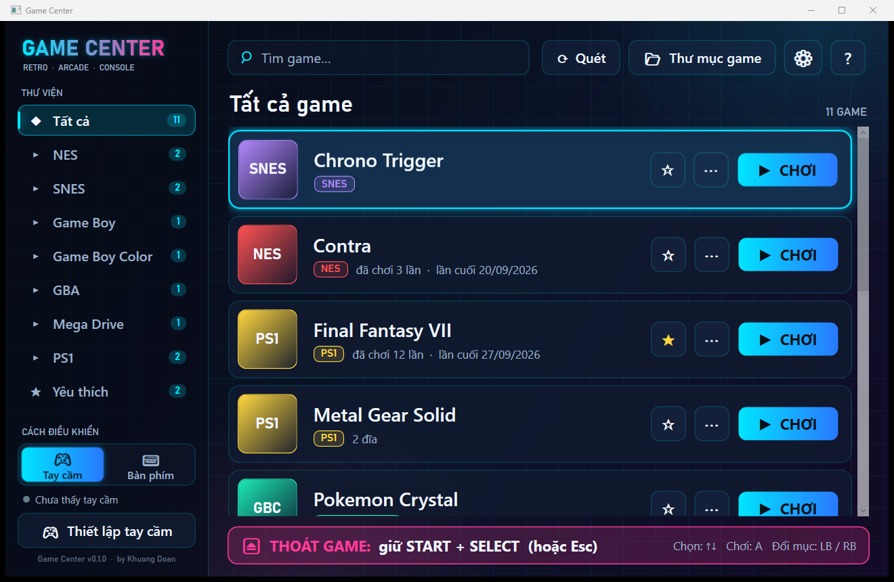
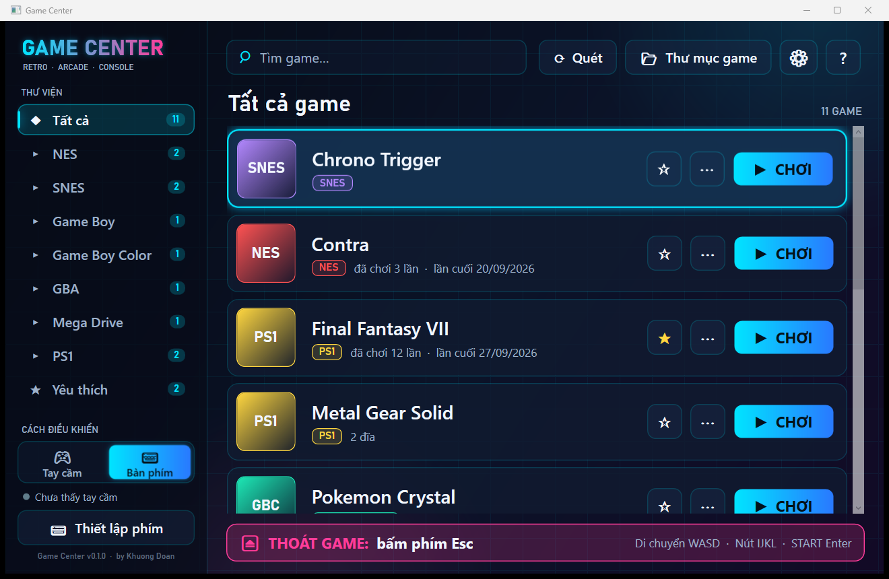
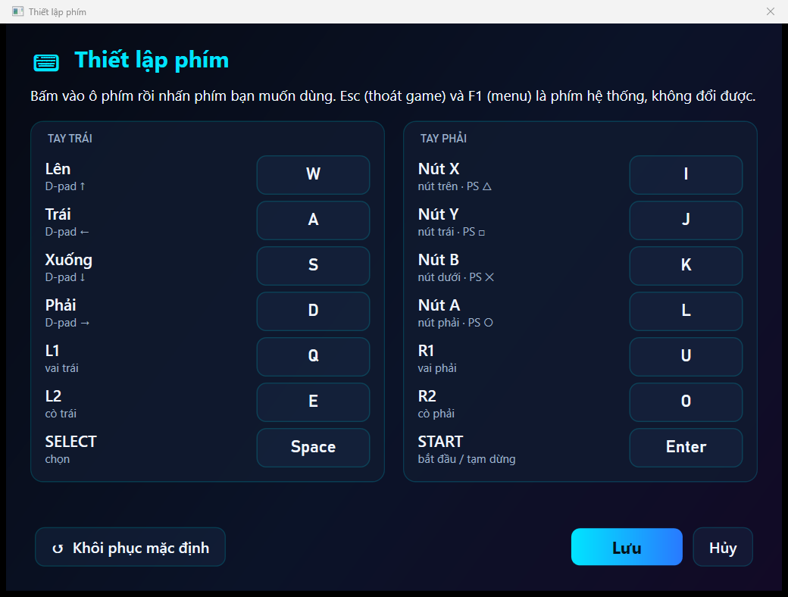

# Game Center: giả lập game retro dễ dùng cho người lớn tuổi

**Tiếng Việt** · [English](README.en.md)

[](https://github.com/2ez4gcx/game-center-retro-launcher/releases/latest)
[](https://github.com/2ez4gcx/game-center-retro-launcher/actions/workflows/release.yml)


**Game Center** là phần mềm **miễn phí** để chơi lại game tuổi thơ trên máy tính **Windows, macOS và Linux**: PS1, PS2, điện tử 4 nút (NES), SNES, Game Boy, GBA, Sega Mega Drive, Master System và Game Gear. Thiết kế cho người lớn tuổi và người không rành máy tính: chữ lớn, nút to, chơi bằng tay cầm hoặc bàn phím, không phải cấu hình gì. Bên trong dùng trình giả lập RetroArch nhưng người chơi không cần biết tới nó. Giao diện **tiếng Việt và tiếng Anh** (bấm nút 🌐 ở góc trái để đổi).

```text
Cài đặt → Next → Finish → Chép game → Chơi
```



## Tính năng chính

- **Cài là chơi:** bộ cài đã kèm RetroArch và 7 core giả lập, không cần tải thêm hay cấu hình.
- **Tự nhận game:** chép game vào thư mục `Games`, Game Center đọc nội dung file để biết game của máy nào (kể cả `.zip`, `.chd`, `.pbp`, `.bin` lẻ) và tự phân biệt đĩa PS1 với PS2.
- **Game nhiều đĩa:** Final Fantasy VII, Metal Gear Solid, The Legend of Dragoon... tự ghép thành một game, đổi đĩa ngay khi đang chơi, mọi đĩa dùng chung một thẻ nhớ.
- **Không mất save:** tự sao lưu save mỗi lần chơi (giữ 10 bản gần nhất) và khôi phục bản cũ ngay trong app; đổi tên file game thì save cũ vẫn đi theo.
- **Khó bấm nhầm:** phải bấm thoát 2 lần mới ra khỏi game; lúc thoát, app hỏi có lưu chỗ đang chơi không bằng câu dễ hiểu.
- **Dễ tìm game:** tìm kiếm không cần gõ dấu, danh sách yêu thích, chơi gần đây.

## Tải về

Tải bản mới nhất ở mục [Releases](https://github.com/2ez4gcx/game-center-retro-launcher/releases/latest). Mọi bản đều đã kèm sẵn .NET 8, RetroArch và các core giả lập, không cần cài thêm gì. **Không kèm game hay BIOS.**

| Hệ điều hành | File | Cách cài |
|---|---|---|
| **Windows** 10/11 (64-bit) | `GameCenter-Setup-x.y.z.exe` | Chạy rồi bấm Next → Finish |
| **macOS** chip Apple (M1–M4) | `GameCenter-x.y.z-macos-arm64.dmg` | Mở file, kéo **Game Center** vào **Applications** |
| **macOS** chip Intel | `GameCenter-x.y.z-macos-x86_64.dmg` | Như trên |
| **Linux** (64-bit) | `GameCenter-x.y.z-x86_64.AppImage` | Cho phép chạy (`chmod +x`) rồi nhấp đúp |

**Windows:** không cần quyền admin, mặc định cài vào `C:\GameCenter` (có thể chọn ổ khác). Game, save, BIOS nằm ngay trong thư mục cài đặt. Gỡ cài đặt **không xóa** game và save.

> ⚠️ **Bản macOS và Linux chưa được kiểm tra trên máy thực.** Mã nguồn đã build và qua kiểm thử tự động cho cả hai hệ, nhưng chưa chạy thử trên một máy Mac hay máy Linux thật. Nếu gặp lỗi, vui lòng [mở issue](https://github.com/2ez4gcx/game-center-retro-launcher/issues) kèm file `~/GameCenter/Logs/gamecenter.log`. Bản Windows đã được kiểm tra đầy đủ.

**macOS / Linux:** game, save, BIOS nằm ở thư mục `GameCenter` trong thư mục người dùng (`~/GameCenter`). Trên macOS, lần đầu mở hãy **chuột phải → Mở** vì app chưa được Apple công chứng.

## Hệ máy hỗ trợ

| Hệ máy | Định dạng | Core | Giấy phép core |
|---|---|---|---|
| NES (điện tử 4 nút, Famicom) | `.nes`, `.zip` | FCEUmm | GPLv2 |
| SNES (Super Famicom) | `.sfc`, `.smc`, `.zip` | Snes9x | Phi thương mại |
| Game Boy / Game Boy Color | `.gb`, `.gbc`, `.zip` | Gambatte | GPLv2 |
| GBA (Game Boy Advance) | `.gba`, `.zip` | mGBA | MPL 2.0 |
| Sega Master System / Game Gear | `.sms`, `.gg`, `.zip` | Genesis Plus GX | Phi thương mại |
| Sega Mega Drive / Genesis | `.md`, `.gen`, `.smd`, `.bin`, `.zip` | Genesis Plus GX | Phi thương mại |
| PS1 (PlayStation) | `.cue`, `.bin`, `.pbp`, `.chd`, `.ccd`, `.m3u` | Beetle PSX HW | GPLv2 |
| **PS2** (PlayStation 2) | `.iso`, `.chd`, `.cso`, `.zso`, `.cue`/`.bin`, `.m3u` | LRPS2 | GPLv3 |

PS1 chơi được ngay không cần BIOS (OpenBIOS). Thêm BIOS bạn tự sao lưu vào thư mục `BIOS\` để tương thích tốt hơn.

**PS2 bắt buộc có BIOS** sao lưu (dump) từ máy PS2 của bạn: chép file BIOS (thường là `SCPH-xxxxx.bin`, 4 MB, tên gì cũng được) thẳng vào thư mục `BIOS\`, Game Center tự chuyển vào đúng chỗ core cần (`BIOS\pcsx2\bios\`). PS2 cần máy tính khá mạnh (nên có CPU 4 nhân và card đồ họa rời hoặc đồ họa tích hợp đời mới) và tay cầm có cần analog. Bản PS2 trên Mac chip Apple chưa được kiểm tra.

## Game Center khác RetroArch thế nào?

Game Center **không thay thế** RetroArch mà là lớp giao diện đơn giản đặt phía trên. Phần chạy game vẫn do RetroArch và các core của nó làm; Game Center lo mọi việc còn lại để người dùng không phải đụng tới RetroArch.

| | RetroArch dùng một mình | Game Center |
|---|---|---|
| **Vai trò** | Trình giả lập đa hệ máy, chạy game | Launcher: quản lý game, gọi RetroArch để chơi |
| **Cài đặt** | Tự tải từng core, tự cấu hình thư mục, BIOS, tay cầm | Bộ cài có sẵn RetroArch, 7 core và cấu hình |
| **Thêm game** | Tự quét hoặc tạo playlist trong menu, phải chọn đúng core | Chép vào `Games`, tự nhận hệ máy theo nội dung file và tự hiện lên |
| **PS1 / PS2** | Tự xử lý `.cue`, tự viết `.m3u` cho game nhiều đĩa, tự đặt BIOS PS2 đúng thư mục | Tự phân biệt đĩa PS1 / PS2, tự ghép đĩa, tự tạo `.cue` cho `.bin` lẻ, tự tạo `.m3u`, tự đặt BIOS PS2 |
| **Giao diện** | Menu nhiều tầng, chữ nhỏ, hàng trăm tùy chọn | Một màn hình, chữ lớn, nút "Chơi" |
| **Điều khiển** | Phải tự gán phím, phím tắt mặc định dễ bấm nhầm (tua nhanh, tạm dừng…) | Phím WASD/IJKL có sẵn, đã tắt các phím tắt dễ nhầm, gán lại bằng cửa sổ đơn giản |
| **Thoát game** | Phải biết tổ hợp phím hoặc vào menu | Luôn hiện hướng dẫn trên màn hình; phải bấm 2 lần mới thoát để tránh lỡ tay |
| **Save state** | Lưu/nạp thủ công, hoặc tự động ngầm | Hỏi khi thoát và khi mở lại, bằng câu dễ hiểu |
| **Tiện ích** | Có nhưng nằm sâu trong menu | Yêu thích, chơi gần đây, tìm kiếm không dấu, sao lưu save |

Nói ngắn gọn: **RetroArch** là "cỗ máy" chạy game, mạnh và linh hoạt nhưng dành cho người rành công nghệ. **Game Center** là "vỏ bọc" dễ dùng: chép game, bấm Chơi, không cần biết emulator là gì. Người rành công nghệ vẫn có thể mở RetroArch trong thư mục cài đặt (`Emulators\RetroArch\retroarch.exe`) để chỉnh sâu hơn.

## Sử dụng

**Thêm game:** chép vào thư mục `Games\`, để chung một chỗ cũng được. Game Center tự nhận ra hệ máy theo nội dung file và tự hiện game mới sau vài giây.

- `.cue` + `.bin` hiện một lần; game nhiều đĩa (kể cả `.chd`, `.iso` để rời `(Disc 1)`, `(Disc 2)`, hoặc mỗi đĩa một thư mục như `The Legend of Dragoon (Disc 1)/`, `(Disc 2)/`) tự ghép, đổi đĩa được khi đang chơi và dùng chung một thẻ nhớ.
- Đĩa PS1 hay PS2 được nhận theo nội dung đĩa (file `SYSTEM.CNF`), không cần để đúng thư mục.
- `.bin` / `.rom` không có `.cue`: nhận đĩa PS1 / PS2 hoặc ROM băng (NES, Game Boy, GBA, Mega Drive, Master System...) theo header.
- `.zip` nhiều ROM: mỗi ROM thành một game.
- File không chạy được (`.7z`, `.rar`, file nén nhiều phần, game đĩa trong `.zip`, game máy chưa hỗ trợ...) nằm ở mục **Chưa nhận ra** kèm hướng dẫn cách xử lý. Chi tiết mọi trường hợp: [docs/nhan-dien-file-nen.md](docs/nhan-dien-file-nen.md).
- BIOS lỡ chép vào `Games\` được tự chuyển sang thư mục `BIOS\`.

**Điều khiển:** chọn **Tay cầm** hoặc **Bàn phím** ở góc trái; bàn phím luôn dùng được song song với tay cầm.

| Tay cầm | Bàn phím (mặc định) |
|---|---|
| D-pad ↑ ← ↓ → | W A S D |
| X / Y / B / A | I / J / K / L |
| L1 / L2 | Q / E |
| R1 / R2 | U / O |
| START / SELECT | Enter / Space |

Đổi phím: **Thiết lập phím** (bấm vào ô rồi nhấn phím mới).

| Chế độ bàn phím | Thiết lập phím |
|---|---|
|  |  |

**Thoát game:** bấm **START + SELECT** trên tay cầm, hoặc **Esc** trên bàn phím, **2 lần liên tiếp**. Lần đầu chỉ hiện "Nhấn lại để thoát...", để lỡ chạm một lần không mất game đang chơi. **F1** mở menu giả lập (đổi đĩa…), **F2 / F4** lưu / tải nhanh. Menu và thông báo của giả lập hiển thị cùng ngôn ngữ với Game Center.

**Save game:**
- Save trong game (memory card, save trong băng) luôn được giữ, tự ghi xuống ổ mỗi 10 giây.
- Khi thoát, Game Center hỏi có **lưu lại chỗ đang chơi** không; lần mở sau hỏi **chơi tiếp** hay **chơi từ đầu**. Tắt được trong Cài đặt.
- **Cài đặt → Sao lưu dữ liệu** nén toàn bộ save thành file zip có ngày.
- Mỗi lần bấm Chơi, Game Center tự sao lưu save của game đó (giữ 10 bản gần nhất). Lỡ hỏng save: bấm **⋯ → Khôi phục save cũ** và chọn thời điểm.
- Đổi tên file game, chép thêm đĩa cho game nhiều đĩa, đổi thư mục dữ liệu: save cũ tự đi theo. "Chơi tiếp" không bao giờ ghi đè save trong game mới hơn. Chi tiết và cách kiểm thử: [docs/bao-toan-save.md](docs/bao-toan-save.md).

**Dùng save thẻ nhớ PS1 có sẵn** (từ giả lập khác hoặc tải về):

1. Tắt game đang chơi (RetroArch chỉ đọc thẻ nhớ lúc mở game).
2. **Cài đặt → Mở thư mục save**, vào thư mục **`Beetle PSX HW`**:
   - Windows: `<thư mục cài>\Saves\Beetle PSX HW\` (mặc định `C:\GameCenter\Saves\Beetle PSX HW\`)
   - macOS / Linux: `~/GameCenter/Saves/Beetle PSX HW/`
3. Nếu đã có file `.srm` cùng tên, chép ra chỗ khác để sao lưu.
4. Chép file thẻ nhớ vào và **đổi tên thành đúng tên file game** (tên file gốc, kể cả "(USA)"), đuôi `.srm`:

   | Game chạy từ | Tên file save |
   |---|---|
   | `Yu-Gi-Oh! Forbidden Memories (USA).bin` hoặc `.cue` | `Yu-Gi-Oh! Forbidden Memories (USA).srm` |
   | Nhiều đĩa: `Metal Gear Solid (Disc 1).cue`, `(Disc 2).cue` | `Metal Gear Solid.srm` (dùng chung mọi đĩa) |
   | `.chd` / `.pbp` | tên file đó + `.srm` |

5. Mở game, vào màn hình Load: save nằm ở Memory Card 1.

| Định dạng thẻ nhớ | Từ đâu | Cách dùng |
|---|---|---|
| `.mcr`, `.mcd`, `.mc`, `.srm` (đúng 128 KB) | ePSXe, DuckStation, PCSX, RetroArch | Chỉ cần đổi tên thành `.srm` |
| `.gme` | DexDrive | Chuyển đổi trước bằng [MemcardRex](https://github.com/ShendoXT/memcardrex) |
| `.psv`, `.mcs`, `.psx` | PS3, save lẻ từng game | Dùng MemcardRex chép vào thẻ nhớ trống, lưu thành `.mcr`, rồi đổi tên |

File dùng được ngay phải nặng đúng **131.072 byte (128 KB)**.

**Điều khiển launcher bằng tay cầm:** ↑↓ chọn game, A chơi, LB/RB đổi mục, Y yêu thích, X thêm tùy chọn, START cài đặt, SELECT trợ giúp.

## Câu hỏi thường gặp

### Game Center có miễn phí không?

Có. Miễn phí hoàn toàn, không quảng cáo, không có tính năng trả phí.

### Có kèm sẵn game không?

Không. Game Center không kèm game hay BIOS. Hãy dùng game và BIOS bạn sở hữu hợp pháp, ví dụ tự sao lưu từ đĩa hoặc băng game của mình.

### Chơi game PS1 có cần BIOS không? Còn PS2?

PS1 không cần, chép game vào là chơi được. PS2 bắt buộc có BIOS sao lưu từ máy PS2 của bạn, xem mục [Hệ máy hỗ trợ](#hệ-máy-hỗ-trợ).

### Game PS1 nhiều đĩa có chơi được không?

Được. Chép các đĩa vào cùng một chỗ (hoặc mỗi đĩa một thư mục), Game Center tự ghép thành một game. Khi game đòi đĩa tiếp theo, bấm **F1** → **Điều khiển đĩa** để đổi đĩa; hướng dẫn từng bước có trong nút **?** của app. Save trên thẻ nhớ dùng chung cho mọi đĩa.

### File game là `.7z` hoặc `.rar` thì sao?

Game hiện ở mục **Chưa nhận ra** kèm hướng dẫn: giải nén ra rồi chép vào `Games`. File `.zip` chứa game băng (NES, SNES, Game Boy, GBA, Mega Drive...) thì chơi thẳng được, không cần giải nén.

### Đang chơi dở trên ePSXe, DuckStation hay RetroArch, có mang save sang được không?

Save thẻ nhớ PS1 dùng lại được: xem phần **Dùng save thẻ nhớ PS1 có sẵn** trong mục [Sử dụng](#sử-dụng).

### Máy tính yếu có chơi được không?

Game các máy đời cũ (NES, SNES, Game Boy, GBA, Mega Drive) và PS1 rất nhẹ. PS2 nặng hơn nhiều: nên có CPU 4 nhân và card đồ họa rời hoặc đồ họa tích hợp đời mới.

### Game Center khác RetroArch thế nào?

Game Center là lớp giao diện đơn giản đặt trên RetroArch, xem [bảng so sánh](#game-center-khác-retroarch-thế-nào).

## Phát triển

Cần .NET 8 SDK.

```
dotnet test
dotnet run --project src/GameCenter.Desktop
```

Chạy với thư mục dữ liệu riêng khi kiểm thử: đặt biến môi trường `GAMECENTER_DATA_DIR`.

| Thư mục | Nội dung |
|---|---|
| `src/GameCenter.Core` | Quét và nhận diện game, SQLite, sinh `retroarch.cfg`, sơ đồ phím, save state, khởi chạy RetroArch |
| `src/GameCenter.Core/Localization/Lang` | Chuỗi giao diện `vi.json`, `en.json`. Thêm ngôn ngữ: thêm file `<mã>.json` cùng khóa (kiểm thử tự kiểm tra thiếu khóa) |
| `src/GameCenter.Desktop` | Giao diện Avalonia (Windows / macOS / Linux), đọc tay cầm bằng SDL2 |
| `tests/GameCenter.Tests` | Kiểm thử |
| `Defaults/` | `platforms.json` (core từng hệ máy), `retroarch-base.cfg` |
| `Licenses/` | Giấy phép Game Center, RetroArch và từng core |
| `installer/` | Bộ cài Windows (Inno Setup) |
| `tools/package-linux.sh`, `tools/package-macos.sh` | Đóng gói AppImage (Linux) và .dmg (macOS) |
| `.github/workflows/release.yml` | Kiểm thử trên 3 hệ điều hành; push tag `v*` thì tự đóng gói và tạo bản nháp Release |
| `tools/fetch-retroarch.ps1` | Tải RetroArch, core và LICENSE vào thư mục publish |

Phát hành:

```
./build.ps1                                                   # test + publish self-contained (kèm .NET 8)
./tools/fetch-retroarch.ps1 -Version 1.22.2                   # RetroArch + core + LICENSE
./tools/e2e-test.ps1 -AppDir ./publish/GameCenter             # kiểm thử với RetroArch thật (save, nhiều đĩa)
& "C:\Program Files\Inno Setup 7\ISCC.exe" installer\GameCenter.iss
```

Trước khi phát hành: chạy `e2e-test.ps1` và làm hết checklist thủ công trong [docs/bao-toan-save.md](docs/bao-toan-save.md#43-thủ-công--checklist-bắt-buộc-trước-khi-phát-hành).

Linux / macOS (chạy trên chính hệ đó, hoặc để GitHub Actions build khi push tag):

```
bash tools/package-linux.sh 1.22.2
bash tools/package-macos.sh arm64 1.22.2      # hoặc x86_64
```

Thiết kế chi tiết: [GAME_CENTER_IMPLEMENTATION.md](GAME_CENTER_IMPLEMENTATION.md).

## Giấy phép

Game Center miễn phí, không quảng cáo, không tính năng trả phí. RetroArch và các core giữ giấy phép riêng (xem `Licenses/`). Snes9x và Genesis Plus GX chỉ cho phép phân phối phi thương mại. Game Center không phải sản phẩm chính thức của Sony, Nintendo hay Sega. Không kèm game hay BIOS.

---

Phát triển bởi **Khuong Doan**: <https://khuongdoan.com/>

<sub>Game Center miễn phí và sẽ luôn như vậy. Nếu nó giúp bạn chơi lại trò chơi tuổi thơ và bạn muốn mời tác giả một ly cà phê, quét mã MoMo bên dưới. Không bắt buộc, không kèm quyền lợi gì thêm. Khoản ủng hộ dành cho phần launcher Game Center, không phải cho các trình giả lập đi kèm.</sub>

<a href="https://github.com/2ez4gcx/Project-hub/blob/main/docs/anh/ung-ho-momo.png"></a>
